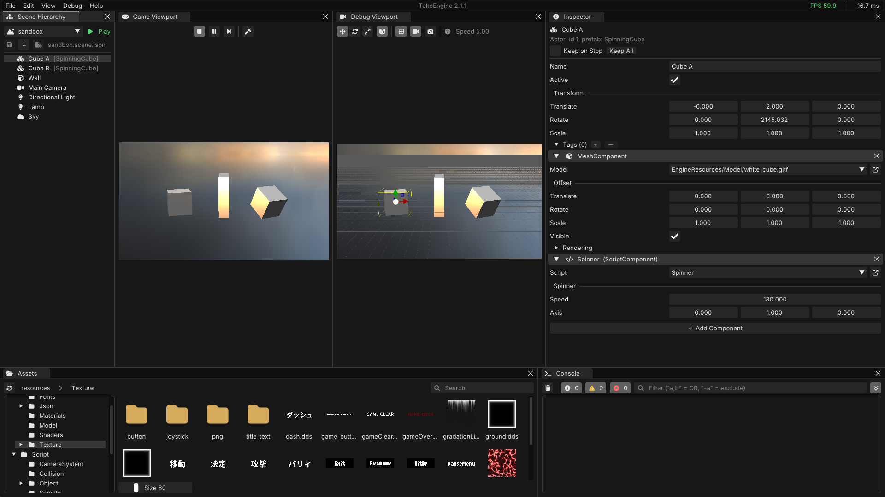

# TakoEngine

[English](README.md) | **日本語**

Windows 向けの DirectX 12 のゲームエンジン。エディタ（TakoEditor）でシーンを作り、C++ のスクリプトを書いてゲームを作る。スクリプトは、エディタを閉じずにコンパイルして差し替えられる。

## 目次

- [特徴](#特徴)
- [要る物](#要る物)
- [はじめかた](#はじめかた)
- [エンジンを開発する](#エンジンを開発する)
- [使っているライブラリ](#使っているライブラリ)
- [変更履歴](#変更履歴)
- [ライセンス](#ライセンス)

## 特徴

**エディタ**
- Actor と Component のシーンエディタ。プレハブ（入れ子にできる）と複数選択
- 全部のエディタで 1 本の Undo / Redo
- Shader・Material・Particle・Animation・Camera Animation・UI Layout・Behavior Tree・Render Pipeline のエディタ
- クラッシュ対策：未保存のシーンを次の起動で読み込める。落ちたときは `Generated/Crashes/` にミニダンプを書く

**C++ スクリプト**
- ホットリロード：エディタからコンパイルし（Ctrl+B か、エディタに戻ったときの Auto Compile）、新しい `Game.dll` に差し替える。プロパティの値と選択は残る
- `TCLASS` / `TPROPERTY` のリフレクション：書くだけで、インスペクターに出て、シーンのファイルに保存される
- 組み込みのコンポーネント：Mesh・Camera・Light・Collider（AABB / OBB / Sphere）・AudioSource・Animator・BehaviorTree・ParticleSystem・PostProcess・SkyBox・UILayout

**描画**
- DirectX 12 とレンダーグラフ。描画の流れ（Render Pipeline）はエディタで変えられる
- ルートシグネチャとリソースのバインドは、シェーダーのリフレクションから作る
- マテリアル・シャドウマップ・デカール・スキニングのアニメーション
- GPU パーティクル・複数パスのポストエフェクト
- ゲーム内の UI の SDF の文字

**配布**
- Release のビルドは exe 1 つ
- ビルド済みの SDK の zip を [Releases](https://github.com/KyouGenSo/TakoEngine/releases) に置く。ゲームのプロジェクトは `UpdateEngine.bat` でエンジンを入れる・新しくする
- 古い保存形式のプロジェクトは、バックアップを取ってから自動で直す

## 要る物

- Windows 10 / 11（64 ビット）と、DirectX 12 に対応した GPU
- Visual Studio 2026 の「C++ によるデスクトップ開発」（スクリプトのコンパイルに使う）

## はじめかた

### エンジンとプロジェクト

| フォルダー | 見分け方 |
|---|---|
| エンジン | `bin`・`build`・`project`・`templates` がある（このリポジトリか、リリースの zip を開いた物） |
| プロジェクト（ゲーム） | `名前.takoproject`・`名前.sln`・`GameProject` がある |

プロジェクトは、自分の中の `Engine\TakoEngine` を通してエンジンを使う。中身は 2 通りある。

- **リンク**：エディタで作ったプロジェクト。作成に使ったエンジンを指す。そのエンジンを新しくすると、リンクしているプロジェクトは全部新しくなる
- **写し**：`UpdateEngine.bat` が入れた物。そのプロジェクトだけのエンジンで、`UpdateEngine.bat` で新しくする

### 新しいゲームを作る

1. [Releases](https://github.com/KyouGenSo/TakoEngine/releases) から `TakoEngine-<バージョン>.zip` を落とし、置き場所を決めて開く。これがエンジンで、後から動かさない
2. `bin\Debug\TakoEditor.exe` を起動する。「No project was specified」と出るので、**No**（新しいプロジェクトを作る）を選ぶ
3. 場所と名前を選ぶ。**エンジンのフォルダーの外**に作る
4. できたプロジェクトの `名前.sln` を Visual Studio で開き、F5 でエディタを起動する
5. スクリプトは `GameProject\Script` に置く（エディタの Assets で `Script` を開き、右クリック > **New Script**）。保存してエディタに戻ると、自動でコンパイルされる（手動は Ctrl+B）
6. 配る物は、構成を **Release** にしてビルドする。`Generated\outputs\Release` に exe ができる

エンジンを新しくするときは、新しい zip を同じ場所に開き直してから、ゲームの sln をビルドし直す。

### チームで作っているゲームに参加する

1. ゲームのリポジトリを clone する（zip で落としてもよい）
2. ルートの `UpdateEngine.bat` を実行する。`.takoproject` に書いてあるバージョンのエンジンが `Engine\TakoEngine` に入る
3. `名前.sln` を Visual Studio で開き、F5 でエディタを起動する

エンジンを新しくするときは、もう一度 `UpdateEngine.bat` を実行する（最新のリリースになる。`UpdateEngine.bat -Version 2.1.0` でバージョンを指定できる）。

> [!NOTE]
> プロジェクトは、自分の sln から起動する。別のエンジンのエディタで開くと、ゲームのコードと合わずに落ちることがある。

## エンジンを開発する

1. このリポジトリを clone し、`project\TakoEngine.sln` を Visual Studio で開いてビルドする。F5 でエディタが起動する
2. テスト用のプロジェクトを、エンジンの外に作る：`bin\Debug\TakoEditor.exe --new <場所> <名前>`。エンジンへのリンクになるので、エンジンをビルドし直すとすぐ反映される（ヘッダーを変えたら、ゲームの sln もビルドし直す）
3. 配る用の zip は `pwsh tools\package_sdk.ps1` で作り、zip だけで使えるかを `pwsh tools\test_sdk.ps1` で確かめる
4. リリースは、`VERSION` と `CHANGELOG.md` を直してコミットしてから `pwsh tools\release.ps1`

## 使っているライブラリ

| ライブラリ | 用途 | ライセンス |
|---|---|---|
| [Dear ImGui](https://github.com/ocornut/imgui) | エディタの UI | MIT |
| [imgui-node-editor](https://github.com/thedmd/imgui-node-editor) | Behavior Tree のエディタ | MIT |
| [Assimp](https://github.com/assimp/assimp) | モデルの読み込み | BSD-3-Clause |
| [DirectXTex](https://github.com/microsoft/DirectXTex) | テクスチャの読み込み | MIT |
| [miniaudio](https://github.com/mackron/miniaudio) | 音 | Public Domain / MIT-0 |
| [nlohmann/json](https://github.com/nlohmann/json) | JSON | MIT |
| [IconFontCppHeaders](https://github.com/juliettef/IconFontCppHeaders) | エディタのアイコン | zlib |

## 変更履歴

[CHANGELOG.md](CHANGELOG.md) にある。

## ライセンス

TakoEngine は [MIT License](LICENSE)。使っているライブラリは、それぞれのライセンスに従う（[使っているライブラリ](#使っているライブラリ)）。
