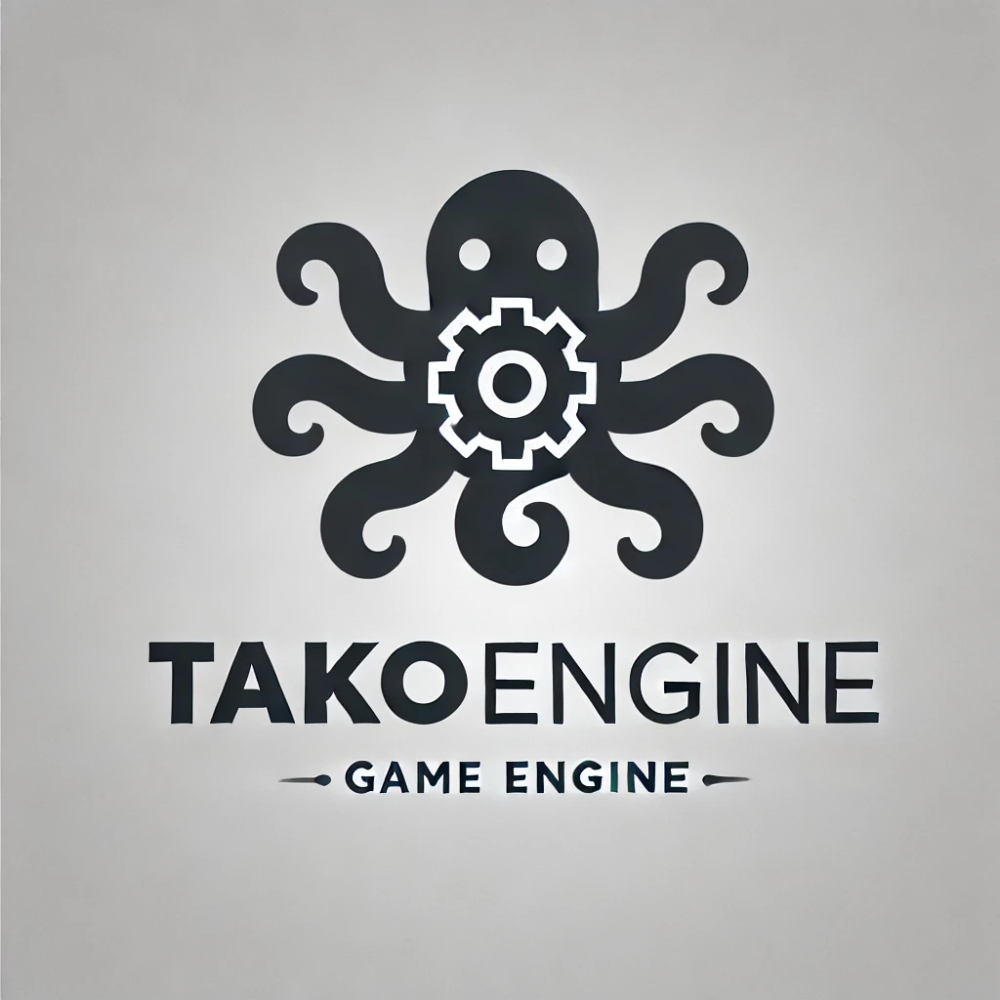

***

# TakoEngine

DirectX 12 のゲームエンジン。エディタ（TakoEditor）でシーンを作り、C++ のスクリプトを書いてゲームを作る。スクリプトは、エディタを閉じずにコンパイルして差し替えられる。

## フォルダーの見分け方

| 種類 | 見分け方 |
|---|---|
| エンジン | `bin`・`build`・`project`・`templates` がある（このリポジトリか、リリースの zip を開いた物） |
| プロジェクト（ゲーム） | `名前.takoproject`・`名前.sln`・`GameProject` がある |

プロジェクトは、自分の中の `Engine\TakoEngine` を通してエンジンを使う。中身は 2 通りある。

- **リンク**：エディタで作ったプロジェクト。エンジンを写さず、作成に使ったエンジンを指す。エンジンを新しくすると、リンクしているプロジェクトは全部新しくなる
- **写し**：`UpdateEngine.bat` が入れた物。そのプロジェクトだけのエンジンで、`UpdateEngine.bat` で新しくする

## 要る物

- Windows 10 / 11（64 ビット）と、DirectX 12 に対応した GPU
- Visual Studio 2026 の「C++ によるデスクトップ開発」（スクリプトのコンパイルに使う）

## 新しいゲームを作る

1. [Releases](https://github.com/KyouGenSo/TakoEngine/releases) から `TakoEngine-<バージョン>.zip` を落とし、置き場所を決めて開く。これがエンジンで、後から動かさない
2. `bin\Debug\TakoEditor.exe` を起動する。「No project was specified」と出るので、No（新しいプロジェクトを作る）を選ぶ
3. 場所と名前を選ぶ。**エンジンのフォルダーの外**に作る
4. できたプロジェクトの `名前.sln` を Visual Studio で開き、F5 でエディタを起動する
5. スクリプトは `GameProject\Script` に置く（エディタの Assets で `Script` を開き、右クリック > New Script）。保存してエディタに戻ると、自動でコンパイルされる（手動は Ctrl+B）
6. 配る物は、構成を Release にしてビルドする。`Generated\outputs\Release` に exe ができる

エンジンを新しくするときは、新しい zip を同じ場所に開き直してから、ゲームの sln をビルドし直す。

## チームで作っているゲームに参加する

1. ゲームのリポジトリを clone する（zip で落としてもよい）
2. ルートの `UpdateEngine.bat` を実行する。`.takoproject` に書いてあるバージョンのエンジンが `Engine\TakoEngine` に入る
3. `名前.sln` を Visual Studio で開き、F5 でエディタを起動する

エンジンを新しくするときは、もう一度 `UpdateEngine.bat` を実行する（最新のリリースになる。`UpdateEngine.bat -Version 2.1.0` でバージョンを指定できる）。

プロジェクトは、自分の sln から起動する。別のエンジンのエディタで開くと、ゲームのコードと合わずに落ちることがある。

## エンジンを開発する

1. このリポジトリを clone し、`project\TakoEngine.sln` を Visual Studio で開いてビルドする。F5 でエディタが起動する
2. テスト用のプロジェクトを、エンジンの外に作る：`bin\Debug\TakoEditor.exe --new <場所> <名前>`。エンジンへのリンクになるので、エンジンをビルドし直すとすぐ反映される（ヘッダーを変えたら、ゲームの sln もビルドし直す）
3. 配る用の zip は `pwsh tools\package_sdk.ps1` で作り、zip だけで使えるかを `pwsh tools\test_sdk.ps1` で確かめる
4. リリースは、`VERSION` と `CHANGELOG.md` を直してコミットしてから `pwsh tools\release.ps1`

変更の記録は [CHANGELOG.md](CHANGELOG.md)。
